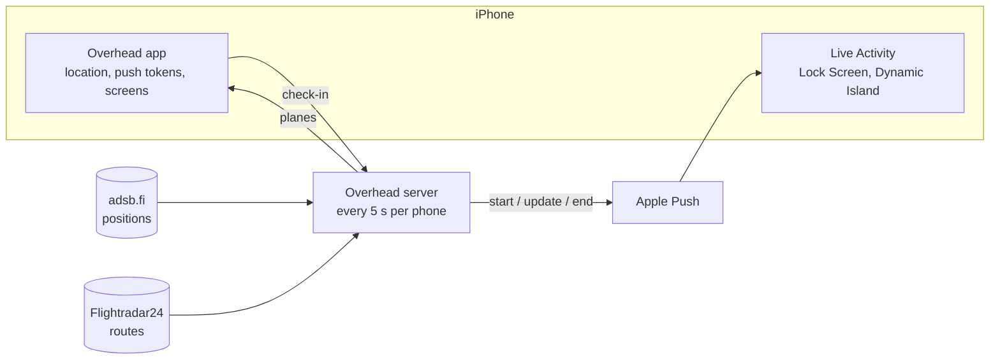

# Overhead

An iPhone app that tells you where the plane above you is coming from and going to, on your Lock Screen, for exactly as long as it is above you.

When a plane flies low and close (below 6,000 ft, within ~2.8 km), a Live Activity appears with its route and a countdown, and disappears once the plane has passed. The app itself is a minimal map of the sky around you plus a "look up" pointer.

## How it works



1. The app checks in with a rough location (~100 m) and its Live Activity push tokens.
2. Every 5 seconds the server finds planes low and close to each phone, looks up their routes and computes how long each stays overhead.
3. A pure policy decides whether to start, update or end the card; Apple Push delivers it.

The policy protects the phone's undocumented Live Activity push budget: routine updates go out at low priority, a stream of planes stays on one card, new cards are capped at 5 per hour, and starts back off when iOS silently drops one.

## Repository

```
shared/   API and Live Activity types, zod request schemas
server/   Node + Express 5 + TypeScript
  src/flights/    positions, routes, geometry, aircraft names, sky
  src/activity/   policy (pure state machine) and watcher (the 5 s loop)
  src/push/       Apple Push client
  src/api/        HTTP API
app/      Expo SDK 58 + Expo Router
  src/app/            screens
  src/live-activity/  the Live Activity (SwiftUI via expo-widgets)
  src/hooks, services, components, lib
```

## Running locally

```bash
npm install
cp server/.env.example server/.env    # add tokens, or leave APNs empty for a dry run
npm start -w server                   # API + watcher on :8080
npm start -w app                      # Metro for the development build
```

With `DEMO_LAT`/`DEMO_LON` set and no APNs config, the server runs a dry run at that spot and prints every card it would send.

## Deployment

The server runs on a Google Cloud e2-micro VM as a systemd service, behind Caddy for automatic HTTPS. `deploy/deploy.sh` ships the committed code, installs the server's dependencies and restarts the service; secrets live only on the VM. The app is built with EAS: `eas build --profile preview` produces an installable build that talks to the deployed server.

## Quality

```bash
npm test          # Vitest: real-world scenarios on a fake clock, APNs over local HTTP/2, captured feed data, app math
npm run typecheck
npm run lint
```

## Data

Positions from [adsb.fi](https://adsb.fi) with [adsb.lol](https://adsb.lol) as fallback, routes from the [Flightradar24 API](https://fr24api.flightradar24.com), city names from [OurAirports](https://ourairports.com/data/) (public domain).
