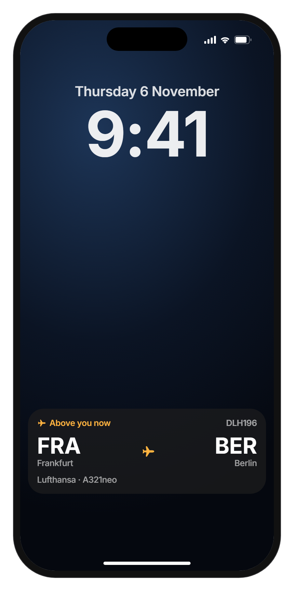
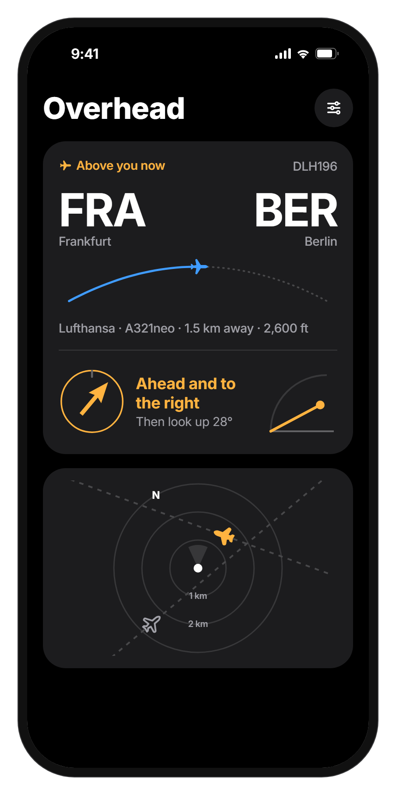
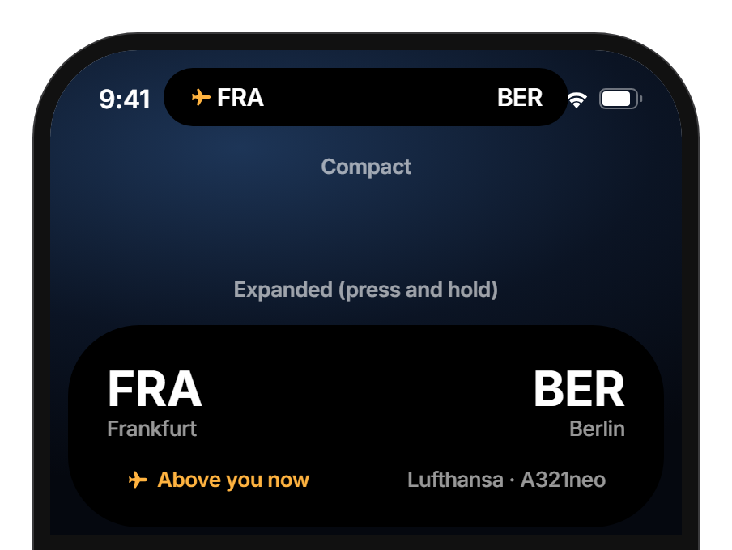
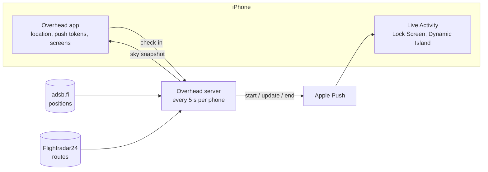

# Overhead

[](https://github.com/eyalhecht/overhead/actions/workflows/ci.yml)

An iPhone Lock Screen card that shows where the low plane above you is flying from and to, while it passes.

**Status:** private beta on TestFlight (November 2026). The server runs on one small VM. **License:** all rights reserved; the code is public to read, not to reuse ([LICENSE](LICENSE)).

When a plane is predicted to pass within about 2.8 km of you below 10,000 ft, or to be loud enough to hear from its type, engine power and distance, a Live Activity appears about 45 seconds before it is closest, as Approaching. It says Above you now while it passes and closes about 20 seconds after it has Passed. The full behavior is in [PRODUCT.md](PRODUCT.md). The app shows the same card with an arrow that turns with your phone, above a map of the sky around you.

<p>
  
  
</p>
<p>
  
</p>

## Engineering highlights

- **A pure state machine decides every card.** [`policy.ts`](server/src/activity/policy.ts) turns planes, time and push results into start, update and end, including the card-token lifecycle. The [watcher](server/src/activity/watcher.ts) is a thin 5-second loop around it.
- **Tests replay real situations on a fake clock**: a plane every 2 minutes for three hours, a server restart mid-pass, feed outages, a circling helicopter ([`real-world.test.ts`](server/test/real-world.test.ts)). Apple Push is tested against a local HTTP/2 server ([`apns.test.ts`](server/test/apns.test.ts)), and flight parsing against captured feed data ([fixtures](server/test/fixtures)).
- **It works within Apple's unpublished Live Activity push budget.** Routine updates go at priority 5, starts and ends at 10, one card switches between planes, and starts are capped and back off when iOS silently drops one. The reasoning is in [docs/research/live-activities-busy-sky.md](docs/research/live-activities-busy-sky.md).
- **Privacy is enforced in code, not just promised.** Locations are rounded to about 100 m on the phone ([`rules.ts`](shared/src/rules.ts), [`api.ts`](app/src/services/api.ts)), the server rounds again, and tests prove logs never contain a location, a device ID or a token, and that the flight feeds only ever see a 10 km area, never who is asking ([`privacy-and-security.test.ts`](server/test/privacy-and-security.test.ts)). Details in [PRIVACY.md](PRIVACY.md).
- **Storage behind a seam.** The [user store](server/src/users.ts) keeps one interface, with SQLite in production and memory in tests, and forgets phones silent for 30 days.

The domain vocabulary is in [CONTEXT.md](CONTEXT.md).

## How it works



1. The app checks in with a rough location (~100 m) and its Live Activity push tokens.
2. Every 5 seconds the server finds planes low and close to each phone, looks up their routes and computes how long each stays overhead.
3. A pure policy decides whether to start, update or end the card, and keeps track of each card's push tokens; Apple Push delivers it.
4. Users and their open card are saved in a SQLite file (`DATABASE_PATH`), so restarts and deploys don't drop anyone. Phones that haven't checked in for 30 days are deleted.

The policy protects the phone's undocumented Live Activity push budget: routine updates go out at low priority, a stream of planes stays on one card, new cards are capped at 10 per hour, and starts back off when iOS silently drops one.

## Repository

```
shared/   API and Live Activity types, zod request schemas
server/   Node + Express 5 + TypeScript
  src/flights/    positions, routes, geometry, aircraft names, sky
  src/activity/   policy (pure state machine) and watcher (the 5 s loop)
  src/push/       Apple Push client
  src/users.ts    user store: in memory, or SQLite when DATABASE_PATH is set
  src/api/        HTTP API
app/      Expo SDK 58 + Expo Router
  src/app/            screens
  src/live-activity/  the Live Activity (SwiftUI via expo-widgets)
  src/hooks, services, components, lib
```

## Try it

The app is a private beta on TestFlight. To try it, email [eyalhe3@gmail.com](mailto:eyalhe3@gmail.com) for an invite.

## Run the tests

Needs Node 22 ([.nvmrc](.nvmrc)) and nothing else: no iPhone, no keys.

```bash
npm install
npm test          # Vitest: real-world scenarios on a fake clock, APNs over local HTTP/2, captured feed data, app math
npm run typecheck
npm run lint
```

CI runs all three on every pull request, plus a secret scan. Running the server and the app yourself is in [docs/development.md](docs/development.md).

## Deployment

The server runs on one Google Cloud e2-small VM in Frankfurt (`europe-west3`) as a systemd service, behind Caddy for automatic HTTPS. `deploy/create-vm.sh` sets up a new VM once; `deploy/deploy.sh` ships the committed code, installs the server's dependencies, restarts the service and waits for `/health`; secrets live only on the VM. The app is built with EAS: the `production` profile builds for TestFlight and talks to the deployed server.

## Limits

Known and accepted for a beta of a few users:

- The watcher checks up to 8 phones at once. Phones in the same 10 km area share one flight-feed call per tick, and each feed gets at most one call a second, so the number of areas, not users, sets the limit: about 5 areas per 5-second tick.
- The server accepts at most 100 phones and forgets a phone after 30 days of silence.
- The app key ships inside the app, so it only keeps out casual callers, and the device ID is the only proof of which phone is calling. Someone who extracts the key could fill the 100 places, and someone who knows another phone's device ID could read its sky. The planned fix is a per-install secret issued by the server (or Apple App Attest) plus rate limiting.
- The server runs its TypeScript directly with `tsx`; a compiled build is the next step.
- Apple publishes no push-to-start budget. The cap of 10 new cards an hour is a measured guess.
- adsb.fi data is free for non-commercial use, which this is today.

## Data

Positions from [adsb.fi](https://adsb.fi) with [adsb.lol](https://adsb.lol) as fallback, routes from the [Flightradar24 API](https://fr24api.flightradar24.com), city names from [OurAirports](https://ourairports.com/data/) (public domain), airline names from [OpenFlights](https://openflights.org/data.php) (Open Database License).
