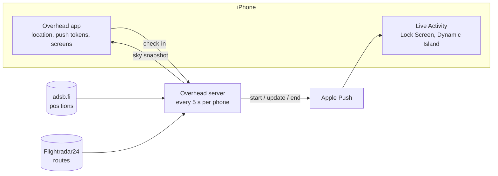

# Overhead

[](https://github.com/eyalhecht/overhead/actions/workflows/ci.yml)

An iPhone Lock Screen card that shows where the low plane above you is flying from and to, while it passes.

**Status:** private beta on TestFlight (November 2026). The server runs on one small VM. **License:** all rights reserved; the code is public to read, not to reuse ([LICENSE](LICENSE)).

When a plane is predicted to pass within about 2.8 km of you, below 10,000 ft, a Live Activity appears about 45 seconds before it is closest, as Approaching. It says Above you now while it passes and closes about 20 seconds after it has Passed. The full behavior is in [PRODUCT.md](PRODUCT.md). The app shows the same card with an arrow that turns with your phone, above a map of the sky around you.

<!-- Screenshots go here: docs/images/lock-screen.png and docs/images/app.png -->

## Engineering highlights

- **A pure state machine decides every card.** [`policy.ts`](server/src/activity/policy.ts) turns planes, time and push results into start, update and end, including the card-token lifecycle. The [watcher](server/src/activity/watcher.ts) is a thin 5-second loop around it.
- **Tests replay real situations on a fake clock**: a plane every 2 minutes for three hours, a server restart mid-pass, feed outages, a circling helicopter ([`real-world.test.ts`](server/test/real-world.test.ts)). Apple Push is tested against a local HTTP/2 server ([`apns.test.ts`](server/test/apns.test.ts)), and flight parsing against captured feed data ([fixtures](server/test/fixtures)).
- **It works within Apple's unpublished Live Activity push budget.** Routine updates go at priority 5, starts and ends at 10, one card switches between planes, and starts are capped and back off when iOS silently drops one. The reasoning is in [docs/research/live-activities-busy-sky.md](docs/research/live-activities-busy-sky.md).
- **Privacy is enforced in code, not just promised.** Locations are rounded to about 100 m on the phone ([`rules.ts`](shared/src/rules.ts), [`api.ts`](app/src/services/api.ts)), and tests prove logs and third parties never see a location, a device ID or a token ([`privacy-and-security.test.ts`](server/test/privacy-and-security.test.ts)). Details in [PRIVACY.md](PRIVACY.md).
- **Storage behind a seam.** The [user store](server/src/users.ts) keeps one interface, with SQLite in production and memory in tests, and forgets phones silent for 30 days.

The domain vocabulary is in [CONTEXT.md](CONTEXT.md).

## How it works



1. The app checks in with a rough location (~100 m) and its Live Activity push tokens.
2. Every 5 seconds the server finds planes low and close to each phone, looks up their routes and computes how long each stays overhead.
3. A pure policy decides whether to start, update or end the card, and keeps track of each card's push tokens; Apple Push delivers it.
4. Users and their open card are saved in a SQLite file (`DATABASE_PATH`), so restarts and deploys don't drop anyone. Phones that haven't checked in for 30 days are deleted.

The policy protects the phone's undocumented Live Activity push budget: routine updates go out at low priority, a stream of planes stays on one card, new cards are capped at 10 per hour, and starts back off when iOS silently drops one.

## Repository

```
shared/   API and Live Activity types, zod request schemas
server/   Node + Express 5 + TypeScript
  src/flights/    positions, routes, geometry, aircraft names, sky
  src/activity/   policy (pure state machine) and watcher (the 5 s loop)
  src/push/       Apple Push client
  src/users.ts    user store: in memory, or SQLite when DATABASE_PATH is set
  src/api/        HTTP API
app/      Expo SDK 58 + Expo Router
  src/app/            screens
  src/live-activity/  the Live Activity (SwiftUI via expo-widgets)
  src/hooks, services, components, lib
```

## Running locally

Needs Node 22 ([.nvmrc](.nvmrc)). The tests, typecheck and lint need nothing else. Seeing a real card needs an iPhone on iOS 17.2 or later (push-to-start Live Activities), a development build of the app from EAS, and Apple Push credentials.

```bash
npm install
cp server/.env.example server/.env    # add tokens, or leave APNs empty for a dry run
npm start -w server                   # API + watcher on :8080
npm start -w app                      # Metro for the development build
```

The app reads `EXPO_PUBLIC_SERVER_URL` and `EXPO_PUBLIC_APP_KEY` from `app/.env`.

With `DEMO_LAT`/`DEMO_LON` set and no APNs config, the server runs a dry run at that spot and prints every card it would send.

## Deployment

The server runs on a Google Cloud e2-micro VM as a systemd service, behind Caddy for automatic HTTPS. `deploy/deploy.sh` ships the committed code, installs the server's dependencies and restarts the service; secrets live only on the VM. The app is built with EAS: `eas build --profile preview` produces an installable build that talks to the deployed server.

## Quality

CI runs all three on every pull request, plus a secret scan.

```bash
npm test          # Vitest: real-world scenarios on a fake clock, APNs over local HTTP/2, captured feed data, app math
npm run typecheck
npm run lint
```

## Limits

Known and accepted for a beta of a few users:

- The watcher checks each phone in turn, with one flight-feed call per phone every 5 seconds. That is fine for tens of users; hundreds need batching by area.
- The server accepts at most 100 phones.
- The app key ships inside the app, so it only keeps out casual callers. There is no rate limiting yet; Apple App Attest is the planned fix.
- Apple publishes no push-to-start budget. The cap of 10 new cards an hour is a measured guess.
- adsb.fi data is free for non-commercial use, which this is today.

## Data

Positions from [adsb.fi](https://adsb.fi) with [adsb.lol](https://adsb.lol) as fallback, routes from the [Flightradar24 API](https://fr24api.flightradar24.com), city names from [OurAirports](https://ourairports.com/data/) (public domain), airline names from [OpenFlights](https://openflights.org/data.php) (Open Database License).
